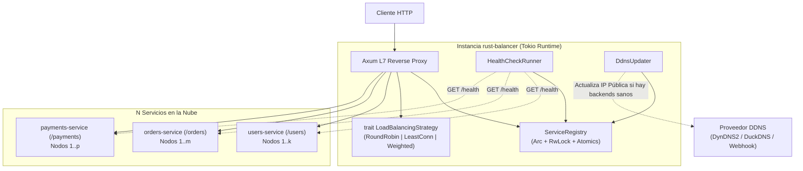

# 🦀 Rust-Balancer — Cloud-Native Layer 7 HTTP Load Balancer & DDNS Coordinator

[](https://github.com/Makmadon/Rust-Balancer/actions/workflows/ci-cd.yml)
[](https://www.rust-lang.org/)
[](LICENSE)

**`rust-balancer`** es un **Balanceador de Carga de Capa 7 (HTTP/HTTPS Reverse Proxy)** de alto rendimiento escrito en Rust asíncrono (`tokio` + `axum` + `reqwest`) para enrutar tráfico hacia **$N$ servicios en la nube**, con **gestión de estado compartido libre de bloqueos (*lock-free*)**, **health checks activos y pasivos**, **sincronización DDNS multi-instancia** y registro dinámico de nodos en caliente.

Desarrollado siguiendo estrictamente el manual **[Apollo GraphQL Rust Best Practices](https://github.com/apollographql/rust-best-practices)**.

---

## ✨ Características Principales

- **Enrutamiento L7 Multi-Servicio ($N$ Servicios Cloud):** Enrutamiento basado en coincidencia del prefijo de ruta más específico (`route_prefix`), con reescritura automática de path (`strip_prefix`) y preservación de `query strings`.
- **3 Algoritmos de Balanceo Intercambiables (`trait LoadBalancingStrategy`):**
  - `round_robin`: Distribución secuencial sin bloqueos mediante cursores atómicos (`AtomicUsize`).
  - `least_connections`: Selección dinámica del nodo saludable con menor número de peticiones en vuelo (`ActiveConnectionGuard` RAII).
  - `weighted_round_robin`: Reparto proporcional al peso (`weight`) asignado a cada instancia backend.
- **Gestión de Estado Compartido de Baja Latencia:**
  - Contadores atómicos por nodo (`AtomicBool`, `AtomicUsize`, `AtomicU32`, `AtomicU64`) en la ruta crítica (cero `Mutex` por petición).
  - `tokio::sync::RwLock` en `ServiceRegistry` y `ServicePool` para lecturas concurrentes masivas y registro de nuevos backends en caliente.
- **Health Checks Activos y Pasivos (`HealthCheckRunner<P: HealthProbe>`):**
  - **Activos:** Sondeo periódico en segundo plano (`GET /health`) con umbrales configurables de caída (`unhealthy_threshold`) y recuperación (`healthy_threshold`).
  - **Pasivos:** Detección inmediata de errores de transporte o respuestas `5xx` durante el tráfico real.
- **Coordinación DDNS Multi-Instancia (`DdnsUpdater<D: DdnsProvider>`):**
  - Sincronización automática de la IP pública de cada instancia del balanceador con proveedores DDNS compatibles con `DynDNS2` / `DuckDNS` / `No-IP` / Webhooks REST.
  - Verifica automáticamente que la instancia tenga servicios saludables antes de anunciar su IP en el DDNS y evita actualizaciones redundantes si la IP pública no ha cambiado.
  - API REST (`POST /_balancer/services/{service}/backends`) para registrar o actualizar nodos backend con IP dinámica en caliente sin reiniciar el balanceador.
- **Seguridad en Tiempo de Compilación (*Type-State Pattern*):**
  - `BalancerBuilder<Unvalidated>` $\rightarrow$ `BalancerBuilder<Validated>` garantiza en tiempo de compilación que `ServiceRegistry` jamás pueda inicializarse con una configuración sin validar.

---

## 🏗️ Arquitectura del Sistema



---

## 📂 Estructura del Proyecto

```text
.
├── .agents/skills/rust-best-practices/ # Skill oficial de Apollo Rust Best Practices
├── .github/workflows/ci-cd.yml         # Pipeline CI/CD (fmt, clippy, tests, docker compose smoke, GHCR)
├── config/
│   └── balancer.toml                   # Configuración declarativa de N servicios, health checks y DDNS
├── src/
│   ├── lib.rs                          # Raíz de la biblioteca pública y documentación ejecutable
│   ├── main.rs                         # Punto de entrada binario (Tokio + graceful shutdown)
│   ├── config.rs                       # Modelos TOML y validación con Type-State Pattern
│   ├── ddns.rs                         # Sincronización DDNS multi-instancia (DdnsUpdater + DdnsProvider)
│   ├── error.rs                        # Jerarquía de errores tipada con thiserror (BalancerError)
│   ├── health.rs                       # Sondeo activo de salud (HealthCheckRunner + HealthProbe)
│   ├── proxy.rs                        # Router L7 Axum, forwarding HTTP y endpoints de control
│   ├── state.rs                        # Estado compartido (ServiceRegistry, ServicePool, BackendNode)
│   └── strategy.rs                     # Algoritmos RoundRobin, LeastConnections y WeightedRoundRobin
├── tests/
│   └── proxy_integration.rs            # Pruebas de integración end-to-end con servidores efímeros reales
├── Dockerfile                          # Construcción multi-stage optimizada (usuario no-root)
└── docker-compose.yml                  # Entorno completo de pruebas con 6 contenedores backend
```

---

## ⚙️ Configuración (`config/balancer.toml`)

```toml
listen_addr = "0.0.0.0:8080"

[health_check]
interval_ms = 5000
timeout_ms = 2000
unhealthy_threshold = 2
healthy_threshold = 2

[ddns]
enabled = false
instance_id = "edge-balancer-1"
hostname = "lb.example.ddns.net"
ip_check_url = "https://api.ipify.org"
update_url = "https://ddns.example.com/nic/update"
interval_ms = 60000
timeout_ms = 5000

[[services]]
name = "users-service"
route_prefix = "/users"
strip_prefix = true
strategy = "round_robin"
health_check_path = "/health"

[[services.backends]]
url = "http://users-backend-1:3001"
weight = 1

[[services.backends]]
url = "http://users-backend-2:3002"
weight = 1
```

### Variables de Entorno
- `BALANCER_CONFIG`: Ruta al archivo TOML de configuración (por defecto `config/balancer.toml`).
- `RUST_LOG`: Filtro de logs estructurados (por defecto `rust_balancer=info,axum=info`).

---

## 🚀 Ejecución Rápida

### 1. Con Docker Compose (Entorno con $N$ Servicios Simulados)

```bash
# Construir y levantar el balanceador + 6 contenedores de microservicios backend
docker compose up --build -d
```

> [!NOTE]
> Si deseas que las actualizaciones de archivos en `./src` o `./config` se sincronicen y reconstruyan automáticamente en vivo sin reiniciar manualmente los contenedores, también puedes usar:
> ```bash
> docker compose watch
> ```

### 2. Con Cargo (Ejecución Nativa)

```bash
BALANCER_CONFIG=config/balancer.toml cargo run --release
```

---

## 🧪 Cómo Probar el Balanceador y la Coordinación DDNS

Con el contenedor corriendo en `http://localhost:8080`:

```bash
# 1. Salud del balanceador
curl -i http://localhost:8080/_balancer/health

# 2. Estado compartido y métricas de los N servicios
curl -s http://localhost:8080/_balancer/status | python3 -m json.tool

# 3. Estado de sincronización DDNS de la instancia
curl -s http://localhost:8080/_balancer/ddns | python3 -m json.tool

# 4. Probar Round-Robin en /users (alterna entre users-backend-1 y users-backend-2)
for i in {1..4}; do curl -s http://localhost:8080/users/profile; done

# 5. Probar Weighted Round-Robin 3:1 en /payments
for i in {1..8}; do curl -s http://localhost:8080/payments/charge; done

# 6. Registrar dinámicamente un nuevo nodo backend con IP/DDNS en caliente
curl -i -X POST http://localhost:8080/_balancer/services/users-service/backends \
  -H "Content-Type: application/json" \
  -d '{"url":"http://users-backend-2:3002","weight":1}'
```

---

## ✅ Ejecutar la Suite de Pruebas y Lints

```bash
# Verificar formato
cargo fmt --all -- --check

# Ejecutar Clippy estricto (0 warnings permitidos)
cargo clippy --all-targets --all-features --locked -- -D warnings

# Ejecutar pruebas unitarias (31 tests)
cargo test --lib --locked

# Ejecutar pruebas de integración end-to-end (4 tests)
cargo test --test proxy_integration --locked

# Ejecutar pruebas de documentación (8 doc-tests)
cargo test --doc --locked
```

---

## 📄 Licencia

Distribuido bajo la licencia **MIT**.
